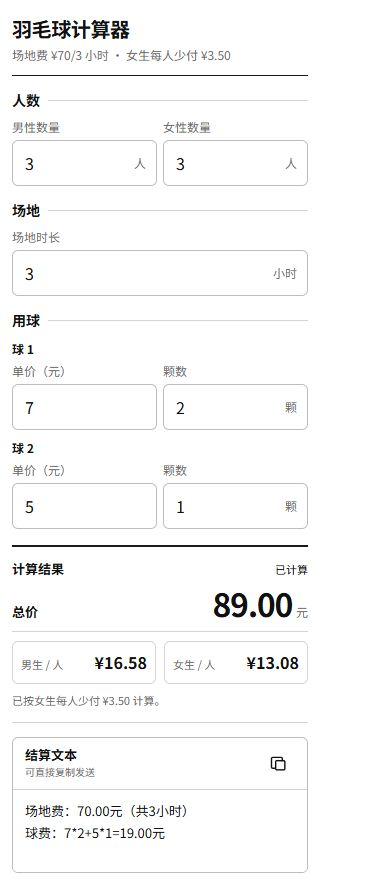

# badminton-calculator

一个手机优先、轻量的羽毛球费用 AA 计算器，页面地址：

<https://choi975.github.io/badminton-calculator/>



## 计算规则

- 场地费 = `70 / 3 × 场地时长`
- 球费 = `球 1 单价 × 球 1 颗数 + 球 2 单价 × 球 2 颗数`
- 总价 = 场地费 + 球费
- 男女都有时，女性每人比男性少付 `3.50` 元
- 只有单一性别时，直接按该类人数均摊
- 球 1 和球 2 的单价保存在浏览器中，下次打开自动填入
- 其他输入项每次打开页面都会清空

设女性每人应付 `x` 元，则：

```text
男性人数 × (x + 3.50) + 女性人数 × x = 总价
```

## 本地预览

```powershell
python -m http.server 4311 --directory designs
```

打开 <http://localhost:4311/badminton-calculator/index.html>。

## 测试

```powershell
node tests/calculator.test.js
```

站点由 GitHub Actions 自动发布，部署内容来自 `designs/badminton-calculator/`。
